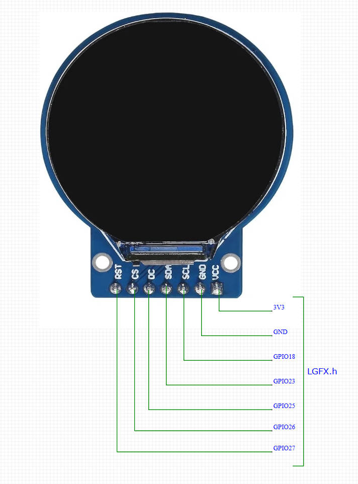

# Schematics

> [!CAUTION]
> 
> Work In Progress

This folder will ultimately contain the full schematics with zoom in/out and directional shift buttons once they are handled by the firmware.

For now it only shows an example of the screen wiring matching the pin definition in file LGFX.h 

You can pick different pins depending on your ESP32 board or component.

I am using a bare ESP32-WROOM-32E but many ESP32 based board should work too.

